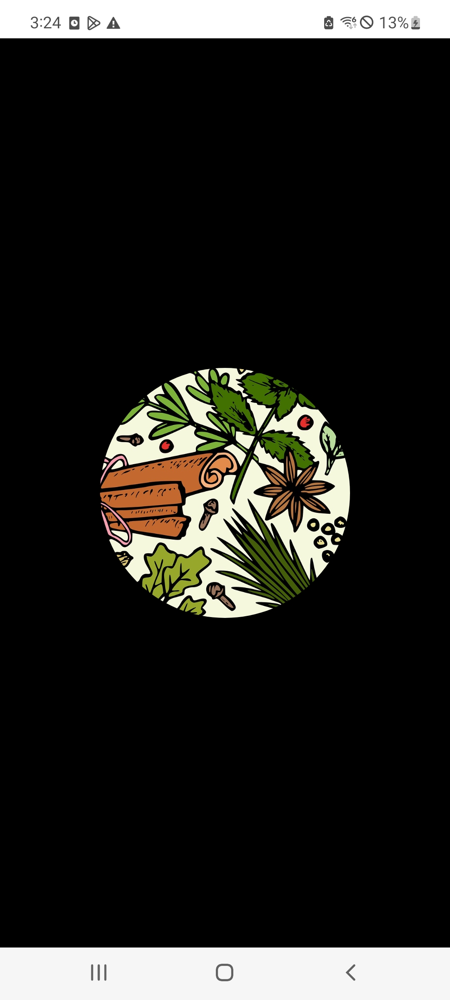
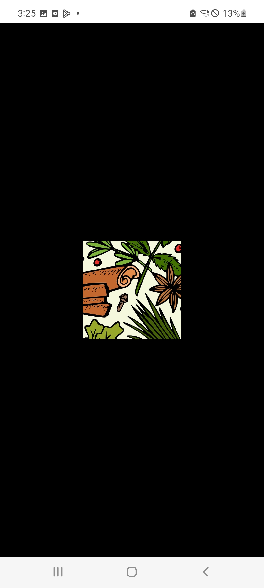
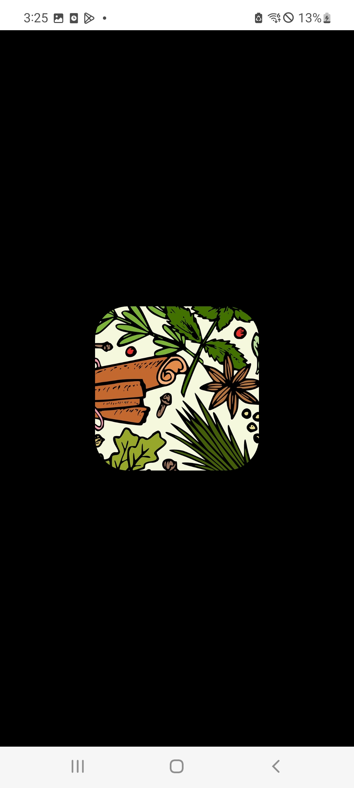

# DrawingMaskView

[](https://jitpack.io/#dantariun/DrawingMaskView)

배경 위에 반투명 오버레이를 깔고, 그 위에 원하는 도형 모양의 **구멍(투명 영역)** 을 뚫어주는 Android Custom View.  
카메라 가이드 프레임, 스캔 영역 표시, 튜토리얼 하이라이트 등에 활용할 수 있다.  
PorterDuff Xfermode 기반으로 동작하며, XML 속성 또는 코드로 도형 타입·위치·크기를 실시간 변경할 수 있다.

|            circle            |         rect          |         rect_round          |
|:----------------------------:|:---------------------:|:---------------------------:|
|  |  |  |


### Gradle

```gradle
allprojects {
  repositories {
    ...
    maven { url 'https://jitpack.io' }
  }
}

dependencies {
    implementation 'com.github.dantariun:DrawingMaskView:x.x.x'
}
```

> 최신 버전은 상단 JitPack 배지 또는 [Releases](https://github.com/dantariun/DrawingMaskView/releases) 페이지에서 확인한다.

### How to use

```xml
<com.pepperkim.drawingmaskview.DrawingMaskView
        android:id="@+id/maskView"
        app:shape_type="circle"
        app:align="center"
        app:shadow_mode="dst_out"
        app:shadow_color="@color/black"
        app:radius_size="100"
        app:shape_width="100"
        app:shape_height="100"
        app:rect_round="100"
        android:layout_width="match_parent"
        android:layout_height="match_parent"/>
```
<br>

```kotlin
val mask: DrawingMaskView = findViewById(R.id.maskView)
mask.changeCircleRadius(100)                              // px 단위
mask.changeShapeType(DrawingMaskView.Shapes.circle.data) // Int
```
<br>

- Property

| attr | type | value | description |
|------|------|-------|-------------|
| shape_type | enum | `circle`, `rect`, `rect_round` | 도형 종류. default: `circle` |
| align | enum | `center`, `top`, `bottom`, `left`, `right`, `top_left`, `top_right`, `bottom_left`, `bottom_right` | 도형 배치 위치. default: `center` |
| shadow_mode | enum | `clear`, `dst_in`, `dst_out` | PorterDuff 합성 모드. default: `dst_out` (도형 영역을 투명하게 뚫음) |
| shadow_color | color / int | 임의 색상 | 오버레이 배경색. default: `Color.BLACK` |
| radius_size | int (px) | 양의 정수 | 원 반지름 크기. default: `100` |
| shape_width | int (px) | 양의 정수 | 사각형 너비. default: `100` |
| shape_height | int (px) | 양의 정수 | 사각형 높이. default: `100` |
| rect_round | int (px) | 양의 정수 | 사각형 모서리 곡률 (`rect_round` 타입에서 사용). default: `10` |

**shadow_mode 동작 설명**

| 값 | PorterDuff Mode | 효과 |
|----|-----------------|------|
| `dst_out` | `DST_OUT` | 도형 영역을 투명하게 뚫음 (기본값, 가장 일반적) |
| `dst_in` | `DST_IN` | 도형 영역만 오버레이가 남고 나머지는 투명 (반전 마스크) |
| `clear` | `CLEAR` | 도형 영역을 완전히 지움 |

<br>

- Method

| function | description |
|----------|-------------|
| **changeAlign**(align: `Aligns.item.data`) | 도형 위치 변경 후 즉시 갱신 |
| **changeShapeType**(type: `Shapes.item.data`) | 도형 종류 변경 후 즉시 갱신 |
| **changePorterDuffXfermode**(mode: `ShadowModes.item.data`) | PorterDuff 합성 모드 변경 후 즉시 갱신 |
| **changeShadowColor**(color: `Int`) | 오버레이 배경색 변경 후 즉시 갱신 |
| **changeCircleRadius**(radius: `Int`) | 원 반지름 변경 (px). 즉시 갱신 |
| **changeShapeWidth**(width: `Int`) | 사각형 너비 변경 (px). 즉시 갱신 |
| **changeShapeHeight**(height: `Int`) | 사각형 높이 변경 (px). 즉시 갱신 |
| **changeRectRound**(round: `Int`) | 사각형 모서리 곡률 변경 (px). 즉시 갱신 |
